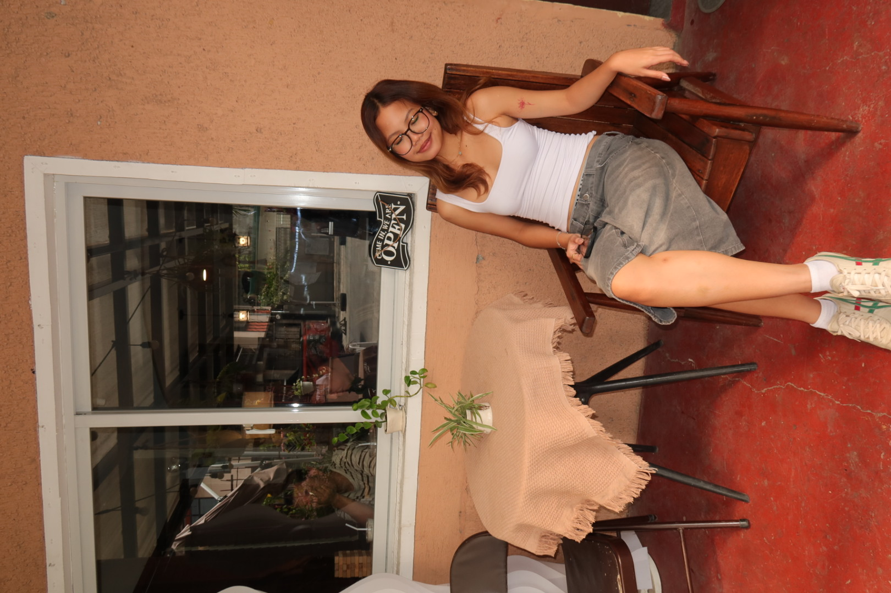
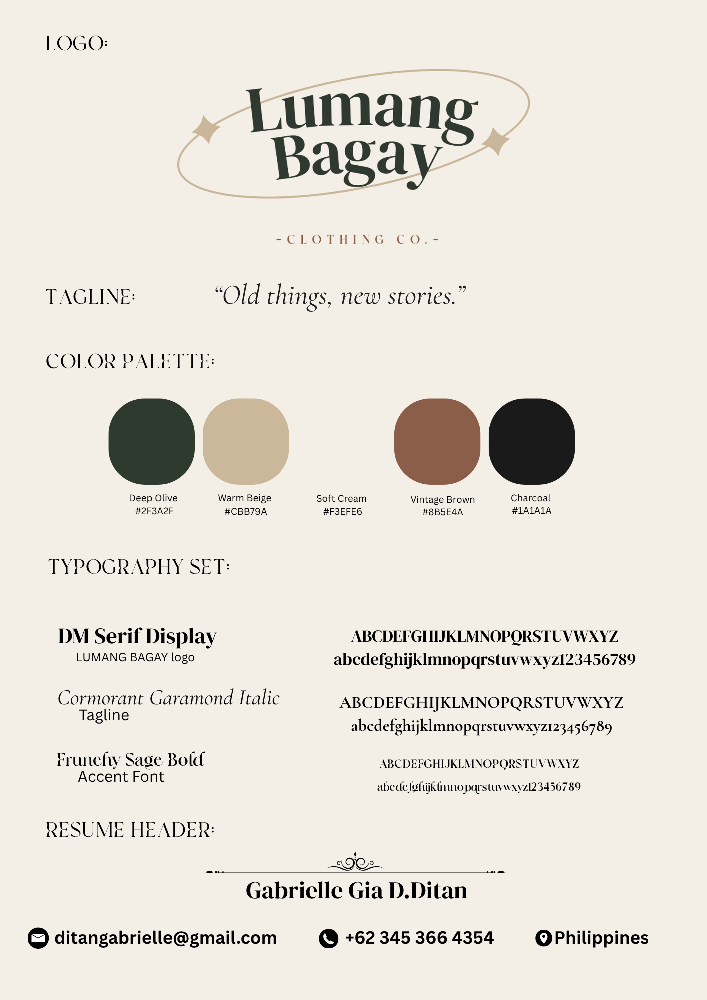

# 🤍 GE 4120: 21ST CENTURY IT SKILLS 🤍

  

---

### 🕊️ About Me & The Portfolio

> *Welcome to my digital portfolio!*
> 
> Hi! I am **Gabrielle Gia Ditan**, a 2nd-year **AB Psychology** student at **Ateneo de Davao University**, interested in **reading, graphic design, and exploring new digital tools**. This space documents my hands-on experience and progress in **GE 4120: 21st CENTURY IT SKILLS**, featuring my collection of class assignments, weekly outputs, technical exercises, and course projects.

**🛠️ Skills & Tools Learned:**

---

### 🤍 My Showcase

 

| 🪞 **ACTIVITY 1** | 🎨 **ACTIVITY 2** | 📱 **ACTIVITY 3** |
| :--- | :--- | :--- |
| **Presentation Design Principles** | **Color Palette & Typography** | **Social Media Infographics & Project Documentation** |
| Mastering visual structure, layout balance, alignment, and typography to build effective, engaging slides. | Building cohesive design systems through accessible color pairings, font hierarchy, and aesthetic color theory. | Translating complex tech solutions into digestible visual infographics and detailed project write-ups. |
| [📂 Open Folder](./Activity-1)  
 
 | [📂 Open Folder](./Activity-2)  
 
 | [📂 Open Folder](./Activity-3)  
   
 |

 

---

 

 

| 📊 **ACTIVITY 5** |
| :--- |
| **AI Tools** |
| This activity was about using an AI tool, creating an original prompt, improving it with the help of another AI, and comparing the results to see how prompt quality affects the generated output. |
| [📂 Open Folder](./Activity-5)  </b>
 
 |

 

---

 

| 📝 **ACTIVITY 6** | 🚀 **ACTIVITY 7** |
| :--- | :--- |
| ** Making a Website** | **Resume Generating** |
| This activity was about creating a one-page website for a business or personal concept by planning its layout, design, and content using website-building tools. | This activity was about creating a one-page professional resume using at least two Large Language Model (LLM) tools with the same prompt, then comparing their outputs to see how they differ in content, formatting, and quality. |
| [📂 Open Folder](./Activity-6)  

<b>Click here</b>
 
 | [📂 Open Folder](./Activity-7)  

<b>Click here</b>
 
 |

 

---

